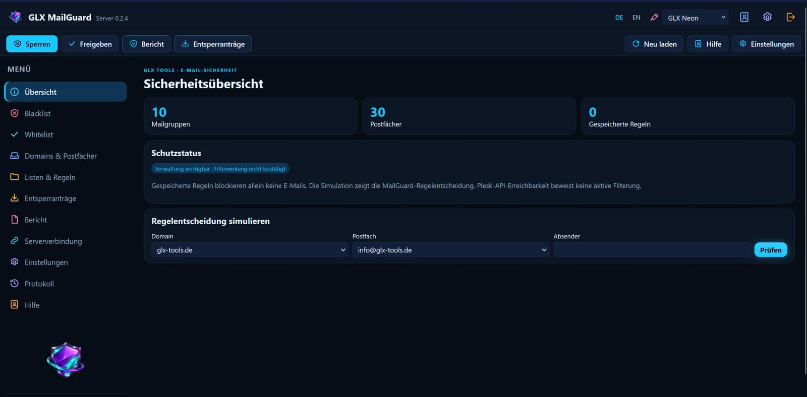
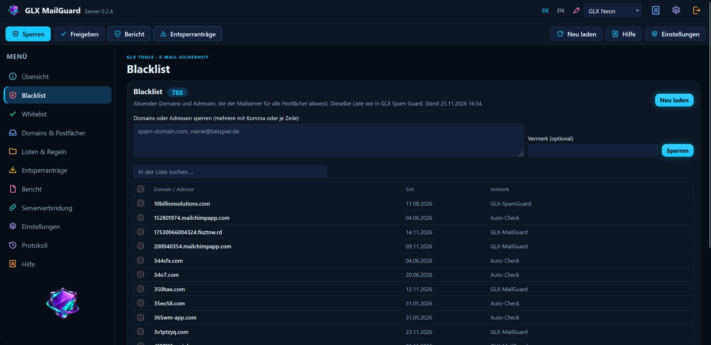
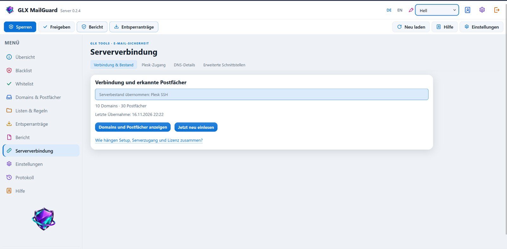
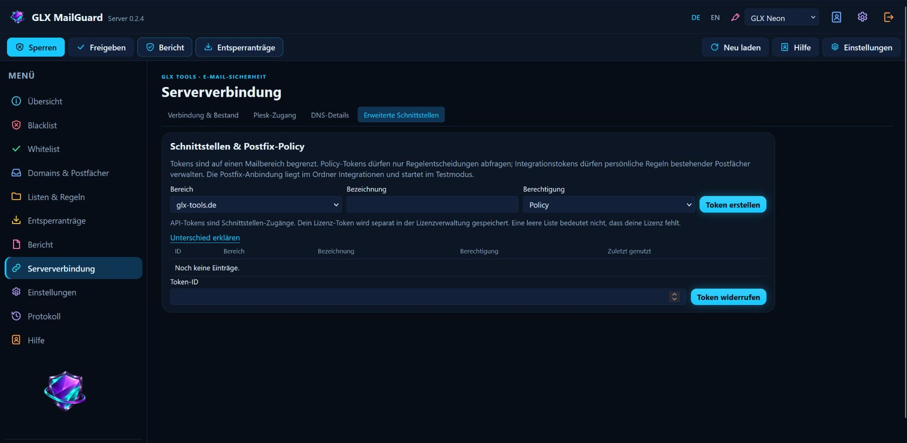
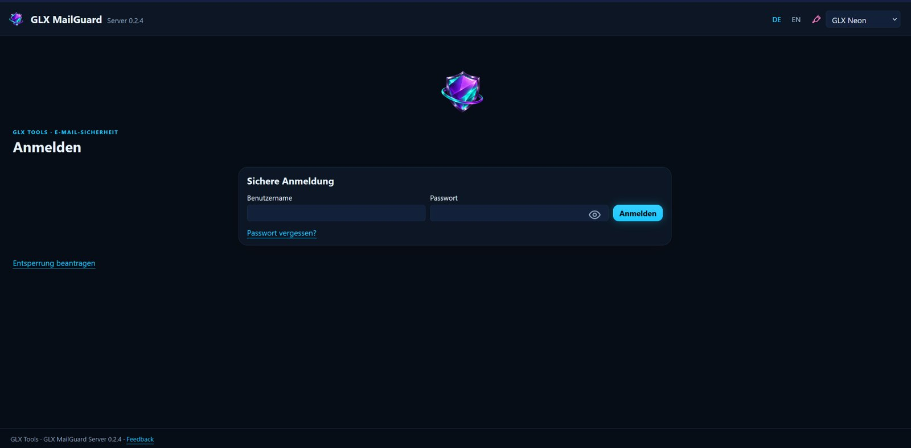
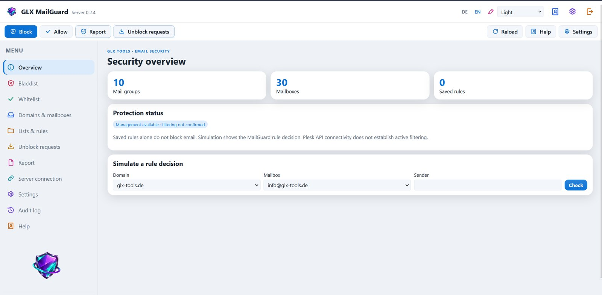

🌍 Sprachen: [🇺🇸 English](README.md) | [🇩🇪 Deutsch](README.de.md)

# 💠 GLX MailGuard Server

### Sperr- und Freigaberegeln für E-Mails auf deinem eigenen Server.

*Domains, Postfächer, Blacklist und Whitelist in einer übersichtlichen Weboberfläche verwalten.* ⚡

   

---

## ⬇️ Download

👉 Shop und Lizenzen: [glx-tools.de](https://glx-tools.de)

---

## 📖 Über GLX MailGuard Server

### 🛡️ Was es ist

GLX MailGuard Server ist eine eigenständige Webanwendung für deinen eigenen Server. Du verwaltest damit die Sicherheitsregeln für deine E-Mail-Domains: welche Absender gesperrt sind, welche immer durchkommen und wer eine Entsperrung beantragt hat. Nextcloud und Node.js brauchst du dafür nicht.

### 📋 Was es kann

Domains, Postfächer und getrennte Mailbereiche liegen an einem Ort. Blacklist und Whitelist gelten wahlweise für ein einzelnes Postfach oder für einen ganzen Bereich, mit Vorrang-Regeln. Listen lassen sich durchsuchen und als CSV oder JSON ein- und ausspielen. Mit der Simulation prüfst du vorher, wie eine Absenderadresse von deinen Regeln behandelt wird.

### ✉️ Entsperranträge

Wer versehentlich gesperrt wurde, kann eine Entsperrung beantragen. Der Antrag wird per E-Mail bestätigt, du prüfst ihn in der Oberfläche und der Antragsteller bekommt Bescheid.

### 🧭 Geführte Installation

Ein Windows-Setup richtet alles über SSH ein, mit vorhandenen PPK- oder OpenSSH-Schlüsseln, optionaler Passphrase und Hilfe an jedem Feld. Alternativ gibt es eine PHP-Webinstallation. Auf Plesk-Servern liest das Programm Domains und Postfächer selbst ein.

### 🎨 Bedienung

Die Oberfläche läuft im Browser am PC und am Handy, auf Deutsch und Englisch, mit zwölf Designs von GLX Neon bis Hell.

### 🧪 Testen und Lizenz

Du kannst GLX MailGuard Server 14 Tage kostenlos testen. Danach schaltest du ihn mit einem Lizenz-Token von glx-tools.de frei.

---

## 📸 Überblick & Screenshots

### 1️⃣ Sicherheitsübersicht mit Regel-Simulation

### 2️⃣ Blacklist für alle Postfächer

### 3️⃣ Serververbindung und erkannte Postfächer (helles Design)

### 4️⃣ Schnittstellen und Postfix-Policy-Tokens

### 5️⃣ Sichere Anmeldung

### 6️⃣ Oberfläche auf Englisch

---

## ✨ Funktionen

- 📂 Domains, Postfächer und Mailbereiche an einem Ort
- 🚫 Blacklist und Whitelist je Postfach oder Bereich, mit Vorrang
- 🔍 Suche, Import und Export als CSV oder JSON
- 🧪 Regelentscheidung simulieren
- ✉️ Entsperranträge mit E-Mail-Bestätigung
- 🔗 Serververbindung über SSH, Plesk-Abgleich, DNS-Details
- 🧩 Schnittstellen-Tokens für die Postfix-Anbindung
- 🌍 Deutsch und Englisch, 12 Designs

---

## 🧩 Systemanforderungen

- PHP 8.2 oder neuer
- MariaDB 10.6+ oder MySQL 8.0+
- HTTPS
- Für aktives Filtern: eine unterstützte Mailserver-Anbindung (z. B. Postfix auf Plesk) mit passenden Rechten

---

## 🧪 Testzeitraum & Lizenz

14 Tage kostenlos testen, danach Freischaltung mit Lizenz-Token von [glx-tools.de](https://glx-tools.de).

---

## 📄 Lizenz

GLX MailGuard Server ist kommerzielle Software von **Dreamworld GLX Tools**, [glx-tools.de](https://glx-tools.de). Der Quellcode wird nicht veröffentlicht.
