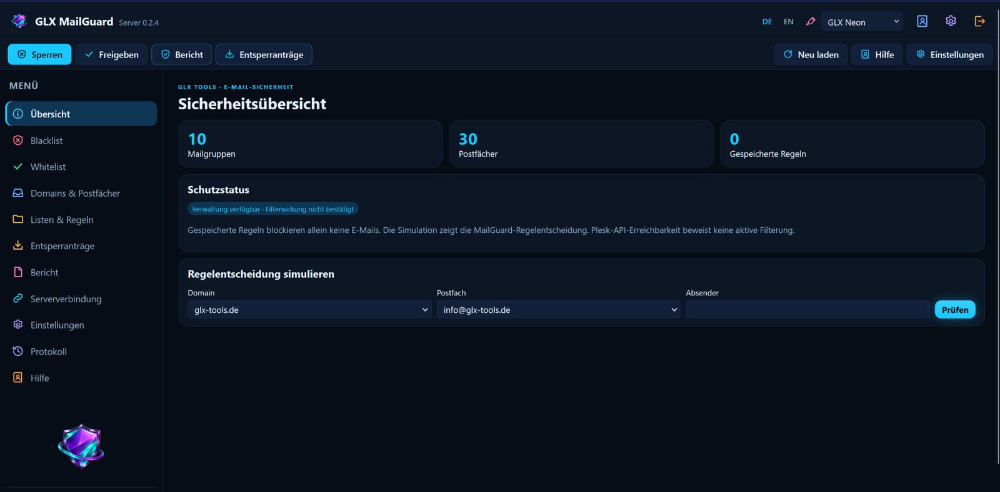
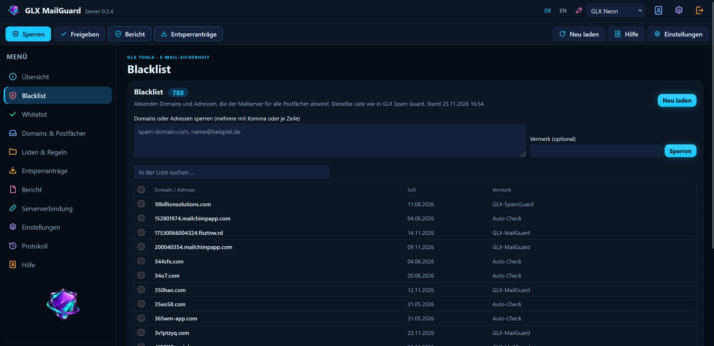
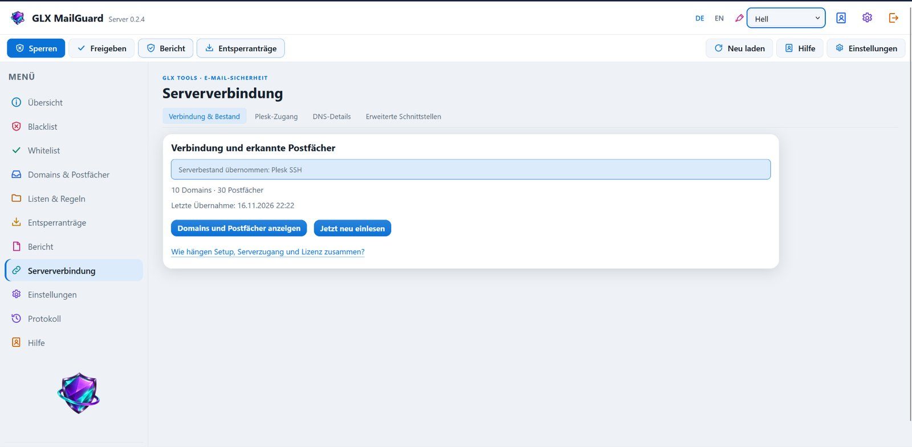
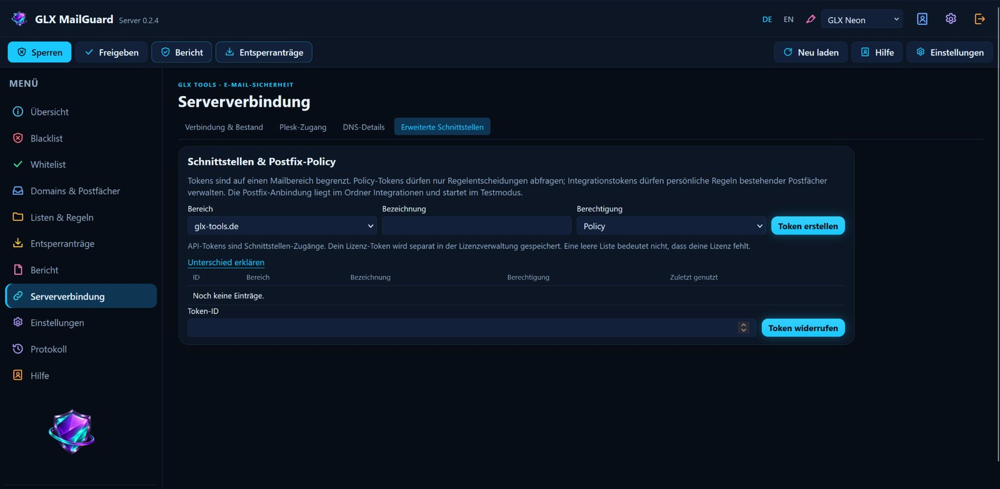
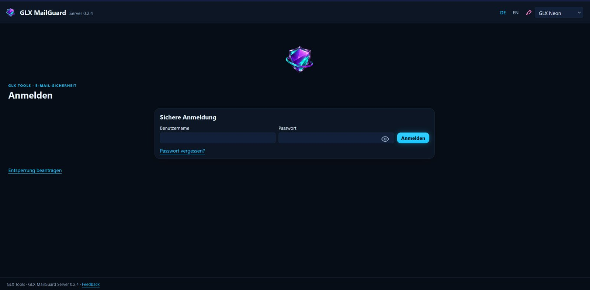
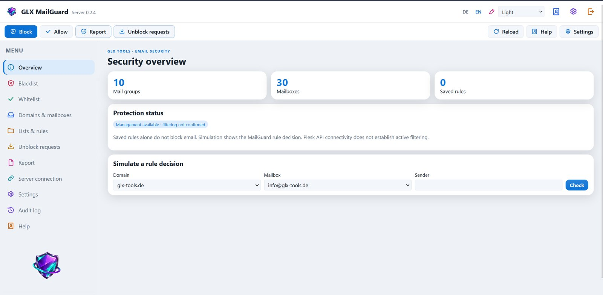

🌍 Languages: [🇺🇸 English](README.md) | [🇩🇪 Deutsch](README.de.md)

# 💠 GLX MailGuard Server

### Email block and allow rules on your own server.

*Manage domains, mailboxes, blacklist and whitelist in a clear web interface.* ⚡

   

---

## ⬇️ Download

👉 Shop and licences: [glx-tools.de](https://glx-tools.de)

---

## 📖 About GLX MailGuard Server

### 🛡️ What it is

GLX MailGuard Server is a standalone web application for your own server. It manages the security rules of your email domains: which senders are blocked, which always get through and who has asked to be unblocked. No Nextcloud and no Node.js required.

### 📋 What it does

Domains, mailboxes and separate mail areas live in one place. Blacklist and whitelist apply to a single mailbox or a whole area, with rule priorities. Lists can be searched, imported and exported as CSV or JSON. The simulator shows in advance how your rules treat a sender address.

### ✉️ Unblock requests

Anyone blocked by mistake can request to be unblocked. The request is confirmed by email, you review it in the interface and the applicant is notified.

### 🧭 Guided installation

A Windows setup installs everything over SSH, with existing PPK or OpenSSH keys, an optional passphrase and help for every field. A PHP web installer is available as well. On Plesk servers the program reads domains and mailboxes by itself.

### 🎨 Look and feel

The interface runs in the browser on PC and phone, in German and English, with twelve designs from GLX Neon to Light.

### 🧪 Trial and licence

Try GLX MailGuard Server free for 14 days, then activate it with a licence token from glx-tools.de.

---

## 📸 Overview & Screenshots

### 1️⃣ Security overview with rule simulation

### 2️⃣ Blacklist for all mailboxes

### 3️⃣ Server connection and detected mailboxes (light design)

### 4️⃣ Interfaces and Postfix policy tokens

### 5️⃣ Secure sign-in

### 6️⃣ Interface in English

---

## ✨ Features

- 📂 Domains, mailboxes and mail areas in one place
- 🚫 Blacklist and whitelist per mailbox or area, with priorities
- 🔍 Search, import and export as CSV or JSON
- 🧪 Simulate a rule decision
- ✉️ Unblock requests with email confirmation
- 🔗 Server connection over SSH, Plesk sync, DNS details
- 🧩 Interface tokens for the Postfix connection
- 🌍 German and English, 12 designs

---

## 🧩 Requirements

- PHP 8.2 or newer
- MariaDB 10.6+ or MySQL 8.0+
- HTTPS
- For active filtering: a supported mail-server connection (e.g. Postfix on Plesk) with sufficient permissions

---

## 🧪 Trial & Licence

Free for 14 days, then activation with a licence token from [glx-tools.de](https://glx-tools.de).

---

## 📄 Licence

GLX MailGuard Server is commercial software by **Dreamworld GLX Tools**, [glx-tools.de](https://glx-tools.de). The source code is not published.
